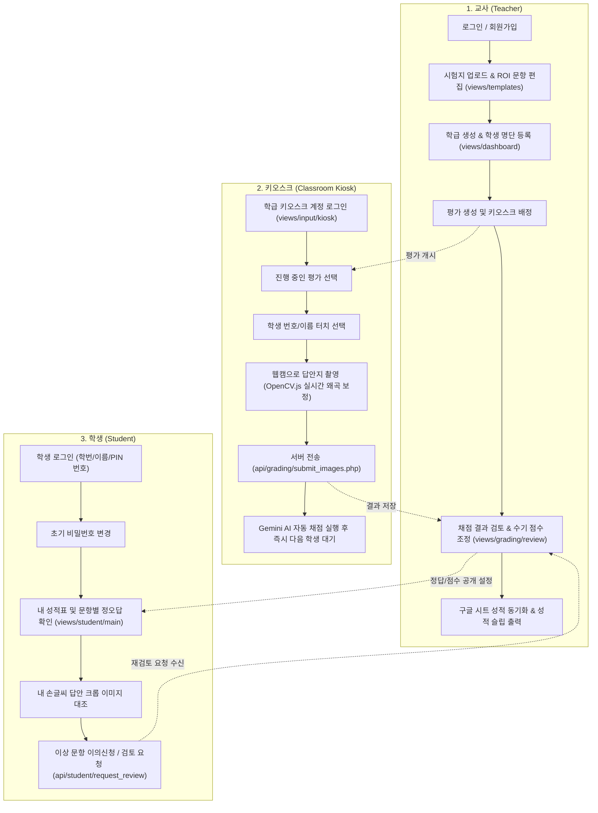
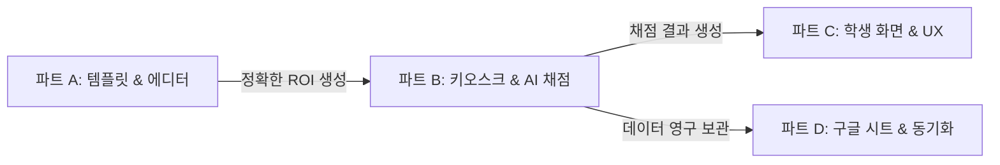

# 쌤글라스(SsamGlass) 완벽 온보딩 & 시스템 가이드 (SSOT)

> **문서 버전:** 2.0 (현행화 완료)  
> **대상:** 프로젝트를 이어받은 개발자, 협업 팀원, 바이브 코딩(AI 프롬프팅) 작업자  
> **핵심 목적:** 시스템 전체 아키텍처 이해, 3대 사용자 흐름 파악, 모듈별 입출력 사전 제공, 연결성(결합도) 주의점 고지, AI 프롬프트 템플릿 제공

---

## 1. 프로젝트 정체성 및 한 줄 요약

**쌤글라스(SsamGlass)**는 초·중·고 교실 현장에서 시험지나 평가지를 웹캠/태블릿 카메라로 촬영하거나 스캔본을 업로드하면, **컴퓨터 비전(OpenCV)과 생성형 AI(Gemini API + Upstage Document OCR)가 학생 답안을 자동 인식·채점**하고, 교사의 검토를 거쳐 **구글 스프레드시트로 성적을 자동 집계·동기화**해주는 지능형 학급 평가 통합 플랫폼입니다.

- **핵심 기술 스택:** PHP 8+, MySQL (PDO), JavaScript (Vanilla, Web Worker, OpenCV.js), Gemini 1.5/2.0 API, Upstage Document Parse API, Google Drive & Sheets API
- **설계 원칙:** 무설치 웹 기반, 모바일/크롬북 최적화, 무중단 자가치유 DB 마이그레이션(Self-Healing Schema)

---

## 2. 코드베이스 현황 진단 ('리팩토링 ssot.md' 대조)

> [!NOTE]  
> **진단 결과: 리팩토링 계획의 약 95% 이상이 이미 실제 코드에 완벽히 구축되어 있습니다.**  
> 과거의 `리팩토링 ssot.md`는 작업 지침서였으며, 현재 저장소는 이미 모던한 표준 디렉터리(`api/`, `views/`, `includes/`, `config/`, `public/`)로 완전히 전환된 상태입니다.

| 영역 | 이전 상태 | 현재 실제 코드베이스 상태 | 비고 |
| :--- | :--- | :--- | :--- |
| **환경 설정 / DB** | 각 파일마다 `.env` 파싱, `db.php` 중복 인클루드 | `config/env.php`, `config/db.php`로 100% 단일화 (SSOT) | 안전한 PDO 인스턴스 공유 |
| **인증 / 세션** | 파일 상단 제각각 세션 처리 | `includes/common/auth.php` 가드 함수로 표준화 | 교사, 학생, 키오스크 세션 완전 분리 |
| **API 엔드포인트** | 루트 경로 혼재 (`api/create_classes.php` 등) | `api/{auth,classes,grading,student,templates,google}/` 체계화 | JSON 응답 규격 통일 |
| **UI 화면 (Views)** | 루트 및 template/ 에 혼재 | `views/{auth,dashboard,grading,input,student,templates}/` 분리 | 역할별 뷰 명확화 |
| **정적 자산 / 업로드** | 루트 상대경로 참조 | `public/assets/`, `public/uploads/{originals,crops}/` 정리 | 웹 접근 및 보안 격리 |
| **레거시 잔재** | 루트 `grading/` 폴더 | 2026-11-05 제거 완료. 과거 하위 호환 프록시였던 `app/grading/` 폴더 전체가 삭제됨 (`objective.php`, `get_results.php`, `grading_review.php`, `NanumGothic.ttf`). 신규 코드는 `views/grading/`, `api/grading/`, `includes/grading/objective.php`만 사용. | 삭제 완료. 실제 호출 경로 없음. 폰트는 `public/assets/fonts/NanumGothic.ttf`로 단일화됨 |

---

## 3. 3대 사용자 사용 흐름 (User Journey Map)

쌤글라스는 **교사(관리자)**, **키오스크(학급 공용 단말)**, **학생(개인 모바일/PC)**의 3가지 주체로 명확히 나뉘어 상호작용합니다.



### (1) 교사(Teacher) 흐름
1. **진입:** `index.php` ➔ `views/auth/login.php`에서 교사 계정으로 로그인.
2. **평가지 준비:** `views/templates/upload.php`에서 시험지(PDF/이미지) 업로드 ➔ Upstage OCR이 문항 자동 파싱 ➔ `views/templates/editor.php`에서 문제별 정답, 배점, 채점 영역(ROI) 확인 및 저장.
3. **학급 및 평가 개시:** `views/dashboard/main.php`에서 학급 생성, 학생 명단 엑셀/시트 동기화 ➔ 템플릿을 선택하여 "평가 배정(Assignment)" 생성.
4. **결과 검토 및 마감:** 키오스크나 스캔으로 올라온 채점 결과를 `views/grading/review.php`에서 확인. 주관식 문항 점수 부여, 인식 오류 수기 수정 ➔ "구글 시트 동기화"로 성적 영구 보관.

### (2) 키오스크(Kiosk - 교실 단말기) 흐름
1. **진입:** 태블릿/크롬북에서 교사ID-학급식별자(예: `star-1`)로 전용 로그인 (`views/input/kiosk.php`).
2. **학생 식별:** 학생이 화면에서 본인 이름/번호를 터치하거나 QR 코드를 태깅.
3. **촬영 및 투시 변환:** 웹캠 화면에 시험지를 비추면 `opencv_worker.js`가 용지 꼭짓점 4개를 찾아 평평한 직사각형으로 자동 왜곡 보정.
4. **자동 제출 & 채점:** 보정된 이미지가 `api/grading/submit_images.php`로 전송되어 백그라운드 AI 채점 진행 ➔ 화면은 1~2초 후 자동으로 다음 학생 대기 화면으로 복귀.
5. **퇴장 방지:** 키오스크 종료 시 교사 PIN 번호 검증 필요(`api/auth/verify_kiosk_logout.php`).

### (3) 학생(Student) 흐름
1. **진입:** `views/student/login.php`에서 본인 학급, 이름, PIN 번호 입력.
2. **성적 및 피드백 열람:** `views/student/main.php`에서 본인의 총점, 문항별 정오답, 내가 쓴 답안 크롭 이미지 확인.
3. **오답 도전 및 이의 신청:** 교사가 모범 답안을 숨겨둔 경우 재도전 기회 제공, 판독 오류가 의심되면 인라인 아코디언 창에서 "선생님께 검토 요청(이의신청)" 작성.

---

## 4. 폴더 구조 및 핵심 파일 입출력 사전 (I/O Catalog)

### 디렉터리 구성 요약
```text
c:\Users\USER\Documents\ssg\
├── config/              # 전역 환경변수(.env) 및 DB(PDO) 연결 관리
├── includes/            # 비즈니스 로직 (Gemini 채점, Upstage OCR, Google API, 인증 가드)
├── views/               # 사용자가 직접 보는 HTML/PHP UI 화면
├── api/                 # 프론트엔드 비동기(Fetch/Ajax) 요청 수신 및 JSON 응답 처리 엔드포인트
├── public/              # 브라우저 직접 접근 정적 자원 (CSS, JS, 폰트) 및 학생 업로드 이미지
├── template/images/     # 등록된 평가지 원본 PDF 및 페이지별 래스터 이미지 저장소
└── index.php            # 시스템 메인 엔트리포인트 (views/auth/login.php로 프록시)
```

### 핵심 파일/API 입출력(I/O) 일람표

| 파일 경로 | 주요 역할 | 입력값 (Request) | 반환값 (Response) |
| :--- | :--- | :--- | :--- |
| **`config/db.php`** | 전역 PDO 연결 & 세션 검증 | 환경변수(`DB_*`), 세션 쿠키 | `$pdo` 객체 생성, 30분 초과 시 세션 만료 처리 |
| **`includes/common/auth.php`** | 3대 권한 검증 가드 | `$_SESSION` | `requireTeacherAuth()`: 교사 ID<br>`requireStudentAuth()`: 학생 ID<br>`requireKioskAuth()`: 학급 ID |
| **`includes/grading/objective.php`** | Gemini AI 객관식 채점기 | ROI 크롭 이미지 배열, 정답/배점 데이터 | 문항별 인식 텍스트(`rawText`), 채점 상태(`status`: 1=정답, 0=오답), 획득 점수 |
| **`includes/common/upstage.php`** | 시험지 자동 문항 파싱 | 원본 시험지 PDF 파일 경로 | 문항 번호, 지문 위치, 보기 영역 좌표(Bounding Box) JSON |
| **`api/auth/login.php`** | 통합 로그인 처리 | `POST`: `username`, `password` | 교사 대시보드 리다이렉트 또는 키오스크 세션 설정 |
| **`api/auth/verify_student_pin.php`** | 학생 PIN 인증 | JSON: `student_id`, `pin` | `{success: true, student_name: "..."}` |
| **`api/templates/save.php`** | 템플릿 ROI 및 배점 저장 | JSON: `template_id`, `roi_data`, `pages_data` | `{success: true, template_id: ...}` |
| **`api/grading/submit_images.php`** | **[핵심]** 답안지 수신 및 채점 | `POST`: `assignment_id`, `students_json` or `image_0` (파일) | 원본 저장, ROI 크롭, Gemini 채점 실행 후 DB `exam_results` 저장 결과 반환 |
| **`api/grading/save_score.php`** | 교사 수기 점수 조정 | JSON: `result_id`, `item_id`, `score`, `status` | `{success: true, total_score: ...}` |
| **`api/student/request_review.php`** | 학생 이의신청 접수 | JSON: `result_id`, `item_id`, `comment` | `{success: true, message: "검토 요청이 접수되었습니다."}` |
| **`api/google/sync_sheet.php`** | 구글 시트 성적 동기화 | JSON: `assignment_id` | 구글 시트에 점수표 행 생성 및 크롭 링크 기록 후 결과 반환 |

---

## 5. 🚨 팀원 필독: 결합도 & 연결성 주의점 (Coupling Caveats)

> [!CAUTION]  
> 이 프로젝트는 프론트엔드 이미지 좌표계, 백엔드 크롭 엔진, 외부 AI API(Gemini, Upstage), 구글 시트가 톱니바퀴처럼 맞물려 있습니다. 아래 4개 지점은 코드를 수정할 때 **절대 임의로 변경해서는 안 되며, 전후 연결성을 반드시 확인해야 합니다.**

### ⚠️ 주의 1: 세션 가드 3총사와 JSON 401 규약 (`includes/common/auth.php`)
- **현상:** 교사용 페이지, 키오스크 화면, 학생 화면이 서로 다른 세션 키(`$_SESSION['user_id']`, `$_SESSION['kiosk_class_id']`, `$_SESSION['student_id']`)를 사용합니다.
- **주의점:** API 파일에서 세션을 검증할 때 단순 리다이렉트(`header('Location: ...')`)를 시키면, 프론트엔드 비동기 `fetch()` 요청에서 HTML 로그인 페이지를 받아 JSON 파싱 에러(`SyntaxError: Unexpected token '<'`)가 발생합니다.
- **원칙:** 모든 API 엔드포인트는 `auth.php`의 `isApiRequest()` 판단을 유지하여 세션 만료 시 반드시 `{success: false, session_expired: true}` JSON 응답을 내려주어야 합니다.

### ⚠️ 주의 2: 키오스크 OpenCV 왜곡 보정과 서버 GD 크롭 좌표 일치
- **현상:** 키오스크(`public/assets/js/opencv_worker.js`)는 촬영된 이미지를 정사각형 또는 A4 정비율로 펴서(Warp Perspective) 서버로 전송합니다.
- **주의점:** `api/grading/submit_images.php`는 `templates.pages_data`에 기록된 원본 템플릿의 가로(`width`), 세로(`height`) 해상도 비율을 기준으로 ROI(`roi_data`)를 크롭합니다.
- **원칙:** 클라이언트 측 캔버스 리사이징 크기를 변경하려면, 반드시 `templates/editor.php`에서 저장하는 템플릿 기준 해상도 및 `submit_images.php`의 정규화 비율 수식과 1:1로 대조해야 합니다. 한쪽만 바꾸면 학생 손글씨가 엉뚱한 위치에서 잘려 나가 오채점됩니다.

### ⚠️ 주의 3: 다쪽(Multi-page) 평가지 데이터 규약 (SSOT Contract A/B/C)
- **현상:** 시험지가 1쪽이 아니라 2쪽, 3쪽 이상일 수 있습니다.
- **규약:**
  - `Contract A (pages_data)`: 템플릿의 쪽수 정보는 `templates.pages_data` JSON 컬럼에 저장됩니다. (부재 시 `includes/common/db_migration.php`가 자동 생성)
  - `Contract B (roi_data)`: 각 ROI 객체는 반드시 `"page": 1` 또는 `"page_uid"` 속성을 가져야 합니다.
  - `Contract C (image_{pIdx})`: 파일 업로드 시 여러 쪽 이미지는 `image_0`, `image_1` 형태로 순차 전송되어야 합니다.

### ⚠️ 주의 4: Gemini AI 프롬프트 스키마 무결성 (`includes/grading/objective.php`)
- **현상:** 객관식 채점 시 Gemini API에 마킹 이미지들을 바둑판 형태로 합성하거나 개별 전송하면서 JSON Schema를 강제합니다.
- **주의점:** 프롬프트 문구나 반환 스키마 키(`rawText`, `status`, `score`)를 바꾸면, `submit_images.php`의 `mergeGradingResults()`에서 키를 찾지 못해 모든 문항이 0점 처리되거나 DB 저장이 실패합니다.

---

## 6. 팀원 역할 분담 및 작동 점검(테스트) 체크리스트

새로 합류한 팀원들에게 아래 4개 파트 중 하나를 배정하여 점검 및 개발을 진행하게 하세요.



### [파트 A] 교사 대시보드 & 템플릿 에디터
- [ ] `views/dashboard/main.php`: 학급 생성, 학생 추가/수정, 템플릿 목록이 정상 로드되는가?
- [ ] `views/templates/upload.php`: PDF 업로드 시 `includes/common/upstage.php` 파싱이 오류 없이 작동하는가?
- [ ] `views/templates/editor.php`: 다쪽 평가지 탭 전환, 마우스 드래그로 ROI 영역 박스 그리기, 정답/배점 저장이 잘 되는가?

### [파트 B] 키오스크 & AI 채점 파이프라인
- [ ] `views/input/kiosk.php`: 웹캠 권한 허용 후 시험지 외곽선 사각형이 초록색으로 잘 잡히는가?
- [ ] `public/assets/js/opencv_worker.js`: 왜곡 보정 후 이미지가 깨지지 않고 전송되는가?
- [ ] `api/grading/submit_images.php` & `includes/grading/objective.php`: `public/uploads/crops/`에 잘린 손글씨 이미지가 생성되고 Gemini API가 올바른 답을 읽어내는가?

### [파트 C] 학생 대시보드 & 이의신청
- [ ] `views/student/login.php`: 학생 학번과 PIN 번호로 로그인이 원활한가?
- [ ] `views/student/main.php`: 교사가 "정답 공개"를 껐을 때 정답이 숨겨지고 오답만 표시되는가?
- [ ] `api/student/request_review.php`: 오답 문항에 검토 요청을 남겼을 때 교사 검토 화면(`review.php`)에 알림/뱃지가 뜨는가?

### [파트 D] 구글 연동 및 백업
- [ ] `api/google/connect.php`: 구글 계정 OAuth 연동이 정상 승인되는가?
- [ ] `api/google/sync_sheet.php`: 채점 완료된 성적이 구글 스프레드시트 지정 시트에 학생별로 잘 기록되는가?

---

## 7. 바이브 코더를 위한 실전 AI 프롬프트 템플릿

바이브 코딩 시 AI에게 아래 템플릿을 복사해서 붙여넣고 요구사항을 작성하면, AI가 기존 아키텍처를 망가뜨리지 않고 정확하게 작업합니다.

### 템플릿 1: 버그를 수정할 때
```markdown
[프로젝트: 쌤글라스 (PHP/MySQL/JS)]
@PROJECT_GUIDE_SSOT.md 파일을 먼저 정독해줘.

현재 {발생한 화면/파일명, 예: views/grading/review.php}에서 다음과 같은 문제가 발생해:
- 현상: {어떤 버튼을 눌렀을 때 무슨 에러가 나는지}
- 기대 동작: {원래 어떻게 동작해야 하는지}

주의사항:
1. 기존의 세션 가드(auth.php) 및 JSON 응답 형식 규약을 깨뜨리지 마.
2. 다른 모듈(키오스크, 채점 엔진)과 연결된 공통 함수를 건드릴 때는 사이드 이펙트를 먼저 검토해줘.
3. 수정한 코드의 전체 변경 이유와 diff를 친절하게 설명해줘.
```

### 템플릿 2: 신규 기능을 추가할 때
```markdown
[프로젝트: 쌤글라스 (PHP/MySQL/JS)]
@PROJECT_GUIDE_SSOT.md 의 3대 사용자 흐름 및 I/O 일람표를 참고해줘.

새로운 기능을 추가하고 싶어:
- 대상 사용자: {교사 / 학생 / 키오스크 중 선택}
- 기능 설명: {예: 학생 대시보드에서 지난 시험 성적 추이 그래프 보기}
- 필요한 작업:
  1. 신규/수정할 뷰(views/) 파일
  2. 신규/수정할 API(api/) 파일과 입출력 규격
  3. 필요한 DB 컬럼이나 테이블이 있다면 알려줘.

기존 폴더 구조 규칙을 엄격히 준수해서 코드를 작성해줘.
```

### 템플릿 3: UI 디자인/사용성을 개선할 때
```markdown
[프로젝트: 쌤글라스 (PHP/MySQL/JS)]
@PROJECT_GUIDE_SSOT.md 를 참고해줘.

{파일명, 예: views/input/kiosk.php}의 사용자 경험(UX/UI)을 개선하고 싶어:
- 개선 목표: {예: 초등학생이 터치하기 쉽도록 큰 버튼과 직관적인 안내 애니메이션 추가}
- 제약 조건:
  - 기존 JavaScript의 카메라 촬영 루프 및 opencv_worker.js와의 메시지 통신 로직을 훼손하면 안 됨.
  - 모바일/태블릿 반응형 스타일 유지.
```

---

> **기록 메모:** 본 문서는 프로젝트의 유일한 진실의 원천(SSOT)입니다. 향후 기능이 크게 변경되거나 새로운 연동 모듈이 추가될 경우 이 문서를 함께 갱신해 주세요.
>
> **참고:** 학생 개인정보 보호 아키텍처 관련 문서는 [STUDENT_PRIVACY_ARCHITECTURE.md](<dev/docs/STUDENT_PRIVACY_ARCHITECTURE.md>) (완료 명세서), 작업 확인·보완 항목은 [WORKFLOW_IMPROVEMENT.md](<dev/WORKFLOW_IMPROVEMENT.md>) §7~§8에 분리되어 있다. 두 문서를 함께 작업할 때는 양쪽 §7의 완료 상태를 동시에 다룬다.
