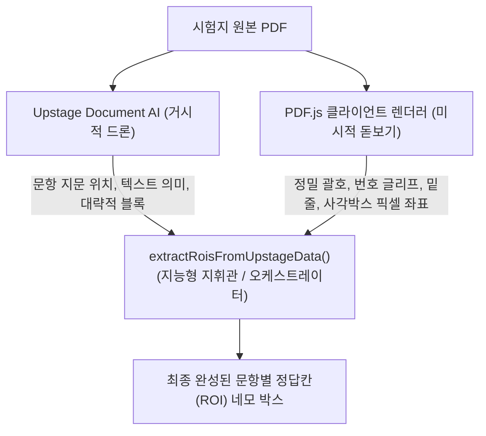
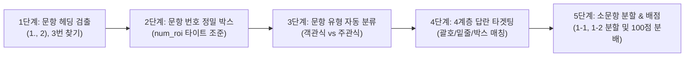
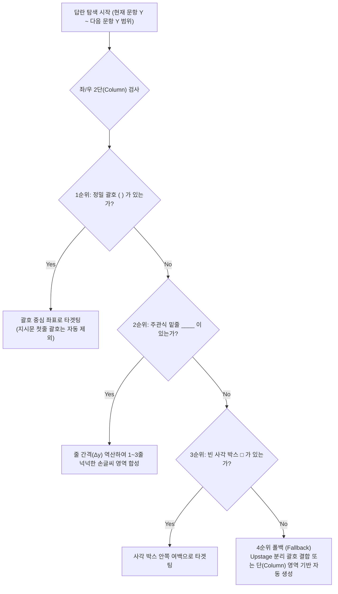

# Upstage 시험지 해석 전략 해설서 (`extractRoisFromUpstageData()`)

> **대상:** 쌤글라스 개발자, 협업 팀원, 바이브 코더  
> **핵심 함수:** [`app/includes/common/upstage.php`](../app/includes/common/upstage.php) 내 `extractRoisFromUpstageData()`  
> **한 줄 요약:** 업로드된 시험지 PDF에서 **"몇 번 문제가 어디에 있고, 학생이 답을 적을 칸(괄호/밑줄)이 어디인지"**를 마우스 클릭 없이 자동으로 찾아내는 하이브리드 인공지능 공간 조준 엔진입니다.

---

## 1. 비유로 이해하는 전체 작동 원리

시험지 자동 분석이 어려운 이유는, 일반 AI OCR에게 시험지를 주면 글자만 죽 읽어낼 뿐 **"한국 학교 시험지의 독특한 규칙(2단 편집, 문항 번호, 정답 괄호, 주관식 밑줄)"**을 알지 못하기 때문입니다.

쌤글라스는 이 문제를 해결하기 위해 **2가지 도구의 장점만 결합한 '하이브리드 듀얼 전략'**을 사용합니다.

1. **Upstage Document AI (드론 시야 - 거시적 분석):**  
   하늘에서 숲 전체를 보듯, "아, 여기가 1번 문제 블록이고, 지문 내용이 '다음 중 알맞은 것을 고르시오'구나"라는 **문맥과 대략적인 위치**를 파악합니다.
2. **PDF.js 기하 엔진 (현미경 시야 - 미시적 분석):**  
   땅 위에서 돋보기를 들이대듯, PDF 내부의 글꼴 벡터를 추적해 `( )` 괄호의 정확한 픽셀 좌표, 밑줄 `___` 선분의 시작과 끝점을 1픽셀 오차 없이 정밀 측정합니다.
3. **`extractRoisFromUpstageData()` (지휘관 - 융합 엔진):**  
   드론의 문맥 정보와 현미경의 정밀 좌표를 결합하여, **"1번 문제 영역 안에 있는 진짜 정답 괄호"**를 찾아내 사각형 박스(`ans_roi`)를 씌웁니다.

---

## 2. 5단계 문서 해석 파이프라인

함수는 시험지 데이터를 전달받아 다음 5단계를 거쳐 순차적으로 해석합니다.

---

### [1단계] 문항 시작점 검출 (Question Discovery)
- **작업 내용:** 시험지 상단/하단의 머리말(학교명, 학년반 등)과 쪽번호를 먼저 걸러냅니다.
- **문항 번호 정규식 매칭:**  
  `^\s*(\d{1,2})\s*([\.|\s|\)|번]|\s*$)` 패턴을 사용하여 `1. `, `1) `, `1번 `, `1 ` 등으로 시작하는 텍스트 블록을 찾아냅니다. (1~100번 지원)
- **정렬:** 페이지 순, 문항 번호 순으로 깔끔하게 번호표를 매깁니다.

---

### [2단계] 문항 번호 영역(`num_roi`) 정밀 앵커링
- **문제점:** AI가 감지한 문항 텍스트 전체를 번호 박스로 잡으면 지문 전체를 가려버립니다.
- **해결 전략:**  
  1. PDF.js가 찾은 번호 글리프(`pageNumbersList`)가 문항 블록 좌상단 반경 **60px 이내**에 있는지 검사합니다. (이렇게 해야 시험지 꼬리말 쪽수나 날짜 `2024년`의 `2`를 문제 번호로 오인하지 않습니다.)
  2. 일치하는 번호가 있으면 그 번호 글리프 크기만큼 딱 맞게 사각형을 씌웁니다.
  3. 번호 글리프가 없으면 1~9번은 가로 34px, 10번 이상은 40px, 높이 26px의 컴팩트한 규격 박스를 부여합니다.

---

### [3단계] 객관식 vs 주관식 의미론적 자동 분류 (NLP Classifier)
선생님이 일일이 "이 문제는 주관식이야"라고 지정하지 않아도, 지문 문맥을 읽어 똑똑하게 분류합니다.

| 구분 | 판별 규칙 (지문 키워드 정규식) | 예시 지문 | 자동 지정 유형 |
| :--- | :--- | :--- | :--- |
| **기호 선택형** | `기호를 쓰시오`, `번호를 쓰시오`, `알맞은 기호` | "다음 보기 중 알맞은 **기호를 쓰시오**." | **객관식 [객]** (㉠, 1 등을 고르는 문항) |
| **순수 주관식** | `쓰시오`, `서술`, `설명하시오`, `까닭`, `이유`, `단답`, `○표`, `V표` | "그렇게 생각한 **까닭을 쓰시오**." "알맞은 곳에 **○표를 하시오**." | **주관식 [주]** |
| **일반 문항** | 위 키워드가 없는 일반 지문 | "다음 중 삼국통일에 대한 설명으로 옳은 것은?" | **객관식 [객]** |

---

### [4단계] 4계층 우선순위 답란(`ans_roi`) 타겟팅

이 함수의 가장 강력한 핵심 로직입니다. 4단계 우선순위에 따라 답안 작성칸을 추적합니다.

#### 🛡️ 핵심 방어 1: 2단(Column) 침범 방지 (좌우 격리)
- 한국 시험지는 한 면에 좌측 단과 우측 단으로 나뉘는 2단 배치가 많습니다.
- 용지 폭의 52%($pw \times 0.52$)를 기준으로 **좌측 단 문제는 좌측 단의 괄호/밑줄만, 우측 단 문제는 우측 단의 괄호/밑줄만 검색**하도록 격리하여 옆 동네 문제를 가로채는 사고를 원천 방지합니다.

#### 🛡️ 핵심 방어 2: 지시문 괄호와 정답 괄호의 구분
- 지문 첫 줄에 *"다음 빈칸 (   )에 들어갈 말로..."* 처럼 괄호가 있고 맨 끝에 진짜 정답 괄호 `(   )`가 또 있는 경우:
- 첫 줄 괄호(`isOnHeadingLine`)는 필터링으로 배제하고, **문항 아래쪽이나 끝에 있는 진짜 답란 괄호를 1순위로 채택**합니다.

#### 🛡️ 핵심 방어 3: 주관식 밑줄 1~3줄 동적 높이 계산 ($\Delta y$)
- 서술형 밑줄이 여러 줄 있을 때, 단순히 밑줄 위에 박스를 치면 학생이 윗줄에 쓴 글씨가 잘립니다.
- 첫째 줄과 마지막 줄의 거리($\Delta y$)를 계산하여 **"출제자가 의도한 1행의 글씨 높이"**를 구한 뒤, 첫 번째 밑줄 위로 $\Delta y$만큼 위로 올리고 마지막 밑줄 아래 8px까지를 감싸는 완벽한 주관식 박스를 자동 생성합니다.

---

### [5단계] 복수 괄호 소문항 분할 & 100점 배점 배분
한 문제 안에 괄호가 여러 개 있는 복합 문항(예: 3번 문제에 빈칸 2개)도 깔끔하게 처리합니다.

1. **소문항 자동 분할:**  
   문항 내에서 유효한 괄호가 2개 이상 검출되면 `display_num: "3-1"`, `"3-2"` 형태의 소문항(`sub_item`)으로 자동 분할 등록됩니다.
2. **배점 자동 계산:**  
   전체 문항 수를 세어 100점 만점을 기준으로 기본 배점을 나눕니다.  
   - 총 20문항이면 문항당 **5점** 자동 할당
   - 소문항이 2개인 문항은 5점을 나누어 **각각 3점, 2점** 등으로 스마트 분할

---

## 3. 요약: 팀원 및 바이브 코딩 시 점검 포인트

| 현상 | 원인 및 확인 위치 |
| :--- | :--- |
| **"문항 번호가 안 잡혀요"** | 시험지의 문제 번호가 `1.`, `1)`, `1번` 형식이 아니거나 100번을 초과하는지 문항 번호 정규식 확인 |
| **"주관식인데 객관식으로 잡혀요"** | 지문 문구에 `쓰시오`, `까닭` 등의 주관식 키워드가 빠져 있는지 확인 |
| **"답란 네모 박스가 엉뚱한 곳에 생겨요"** | 2단 분할 기준점(`$pw * 0.52`) 또는 PDF.js에서 괄호/밑줄 레이어를 제대로 못 읽었는지 확인 |
| **"박스 크기를 기본값으로 바꾸고 싶어요"** | 4단계 폴백의 기본 너비/높이 상수 값(`$ansW`, `$ansH`, `$promptHeight`) 조절 |
