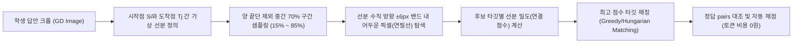

# 📋 쌤글라스(SsamGlass) 채점 기능 및 검수 화면 개선 종합 계획서 (최종안)

> **문서 버전:** 2.0 (사용자 피드백 반영 확정본)  
> **작성 일자:** 2026-11-25  
> **문서 목적:** 검수 화면(`review.php`)의 소문항 계층형 사용성, 부분점수 유연 대응, 다쪽 시험지 크롭 무결성, 선긋기 유형의 비-AI(로컬 이미지 분석, 토큰 0원) 자동 채점 알고리즘, 검수 시작 후 템플릿 수정 시의 재채점 동기화 전략을 수립하고 구체적 구현 계획을 정의합니다.

---

## 1. 종합 진단 및 사용자 결정 요약 (Executive Summary)

사용자 피드백을 통해 4가지 핵심 아키텍처 방향이 명확히 확정되었습니다:

```
┌────────────────────────────────────────────────────────────────────────┐
│                        핵심 점검 영역 및 확정 방향                       │
├────────────────────┬───────────────────────────────────────────────────┤
│ 1. 소문항 검수     │ [A안 확정] 대문항 그룹형 계층 뷰. 과거 composite  │
│    사용성          │ 흔적을 발전시켜 소문항들을 한 화면에 통합 비교 검수 │
├────────────────────┼───────────────────────────────────────────────────┤
│ 2. 선긋기 자동채점 │ [토큰 0원 로컬 알고리즘 확정] Gemini Vision 대신   │
│                    │ GD 기반 픽셀 광선투사(Raycasting) 선분 밀도 분석   │
├────────────────────┼───────────────────────────────────────────────────┤
│ 3. 템플릿 배점변경 │ [B안 확정] 배점 변경 시 부분점수 문항은 pending   │
│                    │ (재검수 필요) 플래그로 전환하여 교사 재확인 유도   │
├────────────────────┼───────────────────────────────────────────────────┤
│ 4. 다쪽 시험지     │ 원본 열람 버튼은 불필요. 2쪽 이상 크롭 및 확장     │
│    대응            │ (expand_crop) 데이터 무결성 보장에 집중            │
└────────────────────┴───────────────────────────────────────────────────┘
```

---

## 2. 영역별 상세 분석 및 개선 설계

---

### [영역 1] 검수 화면 소문항 검수 사용성 개선 (계층형 통합 뷰)

#### 1.1 과거 구현 흔적 분석
- 코드베이스(`app/views/grading/review.php` 라인 722~741, 807~813)를 조사한 결과:
  - 과거에 복합 답안(`composite`) 또는 쉼표 구분 답안에 대해 `답안 [1]`, `답안 [2]` 뱃지를 표시하고 `Tab` 키로 서브 ROI를 전환하거나 확장하는 로직(`compositeSelectorHtml`)이 시도된 흔적이 확인되었습니다.
  - 하지만 이는 단일 크롭 이미지 안에서 단순 문자열 쪼개기 수준에 머물렀고, 현재 공식화된 `sub_item` 데이터 구조(`item_id: 3`, `sub_id: 1` ➔ `3-1`, `sub_id: 2` ➔ `3-2`)와 매칭되지 않아 상단 탭이 `[3-1번]`, `[3-2번]`으로 무한히 파편화되고 있었습니다.

#### 1.2 소문항 계층형 통합 뷰 설계 (A안 확정)
1. **대문항 기준 상단 탭 그룹화:**
   - 상단 문항 탭을 대문항 번호로 통합: `[1번]`, `[2번]`, `[3번 (소문항 2)]`, `[4번]`
   - 탭 클릭 시 해당 대문항에 딸린 모든 소문항(3-1, 3-2)이 한 번에 로드됨.
2. **학생별 소문항 통합 카드 렌더링:**
   - 한 학생의 행(Row) 안에 3-1과 3-2를 나란히(가로 분할 또는 2열 카드) 배치.
   - 각 소문항의 크롭 이미지, 학생 답안(인식값), 정오답 상태를 한눈에 비교.
   - 전체 문항 종합 점수 및 뱃지(`합계: 2 / 4점 [△ 부분점수]`) 표시.
3. **스피드 키패드 서브 포커스 이동:**
   - `[Tab]` 또는 `[←]`/`[→]` 방향키로 3-1 ⇄ 3-2 포커스를 즉시 전환.
   - `[1] (정답)`, `[2] (오답)`, `[3] (부분점수)` 단축키 입력 시 현재 포커스된 소문항에 즉시 반영되고 다음 소문항 또는 다음 학생으로 자연스럽게 진행.
4. **`save_score.php` 소문항 식별자 패치 (P0 버그 해결):**
   - 프론트가 전송한 `item_id`(`3-1`), `sub_id`(`1`), `db_id`를 정확히 대조하여 소문항 점수 수정 시 DB 반영이 누락되는 결함을 완전 차단.

---

### [영역 2] 선긋기(matching_line) 로컬 자동 채점 알고리즘 (토큰 0원)

#### 2.1 요구사항 및 핵심 원리
- **목표:** Gemini Vision API를 호출하지 않고(비용 0원, 지연시간 0초), 학생이 제출한 답안 크롭 이미지(GD resource)만으로 연결선 쌍을 자동 판별.
- **제공된 템플릿 메타데이터:**
  - `ans_roi`: 선긋기 영역의 너비($W$), 높이($H$)
  - `source_dots`: 시작점들의 정규화 좌표 $S_i = (x_{si}, y_{si})$ (예: (1), (2), (3))
  - `target_dots`: 도착점들의 정규화 좌표 $T_j = (x_{tj}, y_{tj})$ (예: ㉠, ㉡, ㉢)
  - `pairs`: 정답 쌍 (예: `(1)-㉢`, `(2)-㉡`)

#### 2.2 GD 기반 픽셀 광선투사(Raycasting) 선분 밀도 분석 알고리즘



1. **양 끝점 마진 제외 (글자/불릿 노이즈 제거):**
   - 시작점 $S_i$와 도착점 $T_j$의 바로 근처(15~20px)는 인쇄된 글자나 점 자체의 검은 픽셀이 있으므로 분석에서 제외.
   - 선분의 진행 비율 $t \in [0.15, 0.85]$ 구간(전체 길이의 70% 순수 선분 영역)만 샘플링.
2. **선분 샘플링 및 적응형 밴드 검출:**
   - 파라미터 $t$를 2픽셀 간격으로 이동하며 기준 좌표 $P(t) = S_i + t \cdot (T_j - S_i)$를 계산.
   - 손글씨 선의 삐침이나 곡률을 감안하여, $P(t)$에서 선분 진행 방향의 수직 벡터 방향으로 $\pm 6\text{px}$ 범위 내의 픽셀들을 검사.
   - 흑색/회색(연필·볼펜 선) 픽셀 판정: `Red, Green, Blue < 145` 또는 `Luminance < 140`.
   - 수직 밴드 내에 어두운 픽셀이 1개 이상 존재하면 해당 샘플링 위치는 "선분 통과(Hit)"로 판정.
3. **연결 점수(Score) 산출 및 매칭:**
   $$\text{Score}(S_i, T_j) = \frac{\text{Hit 개수}}{\text{전체 샘플링 개수}}$$
   - 시작점 $S_i$에 대해 모든 도착점 $T_j$ 후보들의 점수를 계산.
   - 최고 점수 타깃이 유효 임계값(예: 25% 이상)을 초과하면 연결된 것으로 판정.
   - 상호 배타적 매칭(가장 확신도 높은 쌍부터 순차 할당)을 적용하여 학생 연결 쌍 `detected_pairs` 도출.
4. **검수 화면 연동:**
   - 교사 검수 화면에서는 AI/로컬이 감지한 연결 결과(예: `인식: (1)-㉢ [O], (2)-㉠ [X]`)가 뱃지로 표시되며, 교사가 눈으로 보고 틀린 항목을 클릭 1회로 즉시 정정 가능.

---

### [영역 3] 템플릿 사후 수정 시 부분점수 문항 처리 (B안 확정)

#### 3.1 확정 정책: 부분점수 문항 재검수 대기 (`Pending`) 전환
교사가 시험 시작 후 템플릿 에디터에서 배점을 수정했을 때:
1. **정답(만점) 문항:**
   - 기존에 만점을 받았던 학생은 수정된 새 배점으로 자동 갱신.
2. **오답(0점) 문항:**
   - 0점 유지.
3. **부분점수가 적용되었던 문항 (B안):**
   - **`status: -1 (pending, 검수 대기)`으로 전환하고 `currentScore: 0`으로 리셋.**
   - 해당 문항에 `[⚠️ 배점 변경: 재검수 필요]` 주황색 알림 뱃지 부착.
   - 교사가 검수 화면에 들어왔을 때 변경된 배점 기준에 따라 직접 확인하고 점수를 다시 확정하도록 유도.
4. **교사 수기 검수 결과 보호:**
   - 교사가 직접 첨삭한 주관식 문항 등은 덮어쓰지 않고 보호.

---

### [영역 4] 다쪽 시험지 대응: 크롭 및 확장 무결성 보장

#### 4.1 본질에 집중 (원본 열람 버튼 배제)
- 사용자의 피드백대로, 복잡한 "전체 시험지 원본 열람 모달 팝업"은 개발 범위에서 제외합니다.
- 검수 화면의 본질은 **"학생 답안의 크롭 이미지가 정확하게 보이고, 필요할 때 상하좌우로 정확하게 확장(`expand_crop`)되는 것"**입니다.

#### 4.2 치명적 버그 수정 명세
1. **`app/includes/grading/objective.php` 라인 440~452 패치:**
   - 채점 결과 배열 생성 시 누락되었던 `page`와 `image_path` 필드를 명시적으로 주입:
     ```php
     $finalResults[] = [
         'item_id'        => $id,
         'id'             => $id,
         'page'           => (int)($item['page'] ?? 1),          // 👈 복원!
         'image_path'     => (string)($item['image_path'] ?? ''), // 👈 복원!
         'display_num'    => $item['display_num'] ?? (string)$id,
         'sub_id'         => $item['sub_id'] ?? null,
         ...
     ];
     ```
2. **`app/api/grading/submit_images.php` 라인 447 패치:**
   - 2쪽 이상 문항의 `image_path`가 1쪽 이미지로 덮어씌워지던 로직 제거:
     ```php
     foreach ($finalRawResults as &$rItem) {
         if (empty($rItem['image_path'])) {
             $itemPage = (int)($rItem['page'] ?? 1);
             $rItem['image_path'] = $pageOriginalUrls[$itemPage] ?? $localOriginalUrl;
         }
     }
     ```
3. **`expand_crop.php` 다쪽 시험지 무결성 보장:**
   - 2쪽 문항 확장 요청 시, 2쪽 원본 이미지 파일에서 정확한 좌표로 크롭하여 반환하도록 검증 보장.

---

## 3. 세부 구현 로드맵 및 단계별 작업 계획

```
┌────────────────────────────────────────────────────────────────────────┐
│                        단계별 작업 계획 (Roadmap)                       │
├─────────┬──────────────────────────────────────────────────────────────┤
│ Phase 1 │ [P0 긴급] 데이터 무결성 및 치명적 버그 수정                  │
│         │ 1. objective.php / submit_images.php 다쪽 page/image_path 보존 │
│         │ 2. save_score.php 소문항(display_num, sub_id) 매칭 패치     │
│         │ 3. regrade_pending.php JSON 요청 파싱 패치                   │
├─────────┼──────────────────────────────────────────────────────────────┤
│ Phase 2 │ [P1] 선긋기(matching_line) 로컬 자동 채점기 구현 (토큰 0원)    │
│         │ 1. gemini_matching.php에 GD Raycasting 기반 선분 채점 함수 구현│
│         │ 2. submit_images.php에서 matching_line 로컬 채점 분기 연결   │
│         │ 3. review.php에 선긋기 연결 결과 UI 뱃지 및 토글 기능 추가   │
├─────────┼──────────────────────────────────────────────────────────────┤
│ Phase 3 │ [P1] 검수 화면 소문항 계층형 통합 뷰 (A안) 구현              │
│         │ 1. 대문항 그룹핑 상단 탭 UI 개편                             │
│         │ 2. 소문항 카드(3-1, 3-2 나란히 보기) 및 키패드 Tab 이동 연동 │
│         │ 3. 문항 헤더 채점 기준(criteria) 안내 바 및 부분점수 퀵버튼 │
├─────────┼──────────────────────────────────────────────────────────────┤
│ Phase 4 │ [P2] 템플릿 사후 수정 시 스마트 재채점 엔진 구축             │
│         │ 1. templates ↔ exam_results 변경 감지 해시 로직             │
│         │ 2. api/grading/regrade_by_template.php (부분점수 pending 전환)│
│         │ 3. review.php 템플릿 변경 알림 배너 및 재채점 모달 UI 연동    │
└─────────┴──────────────────────────────────────────────────────────────┘
```
